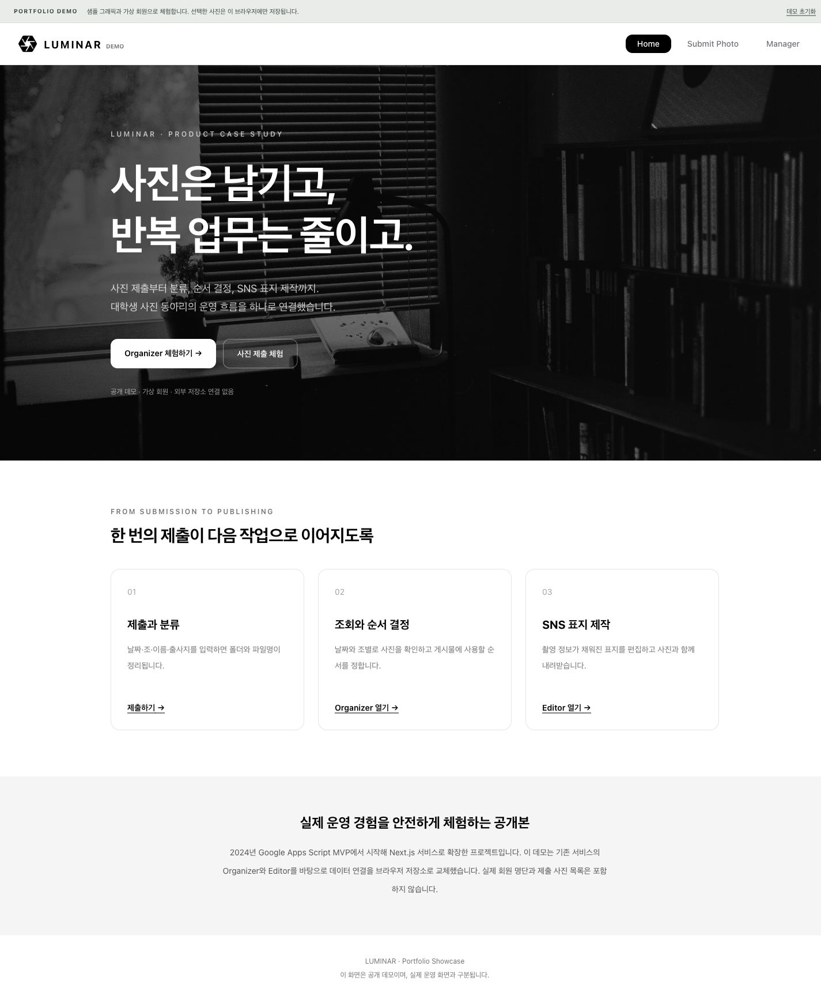
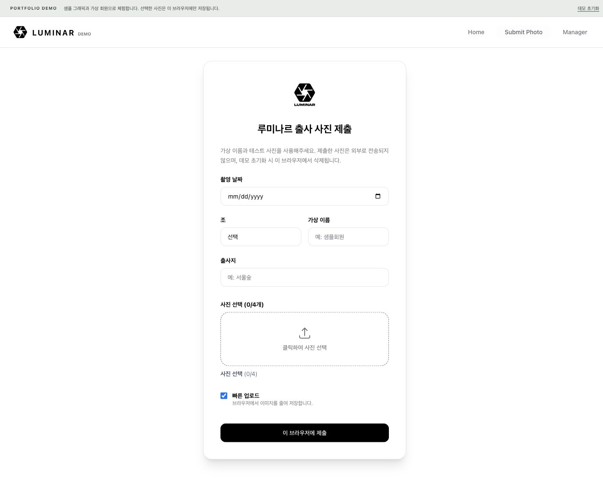
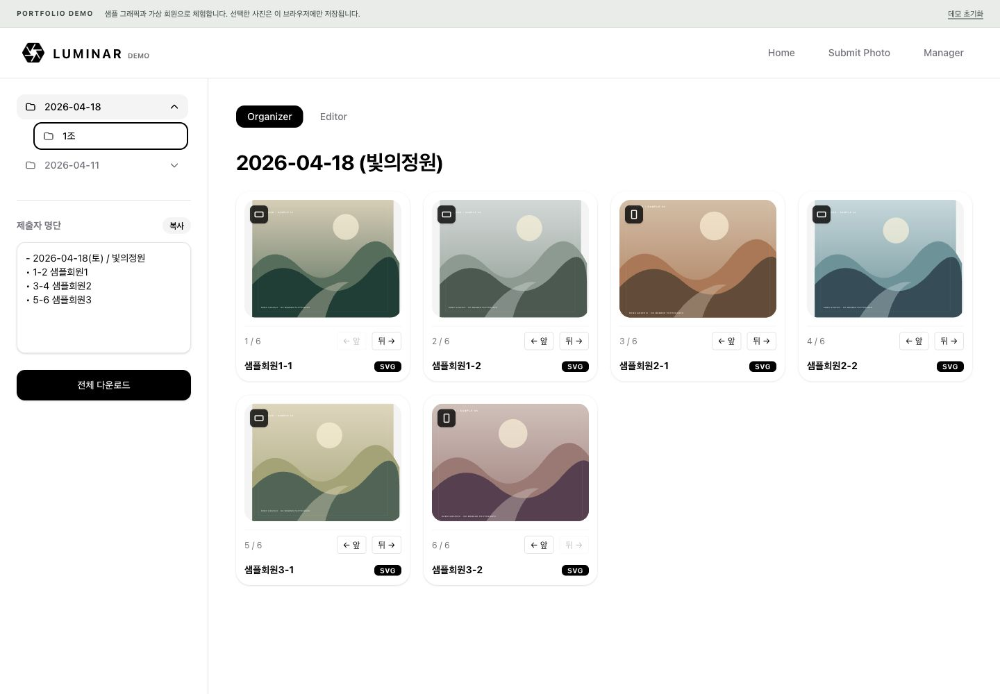
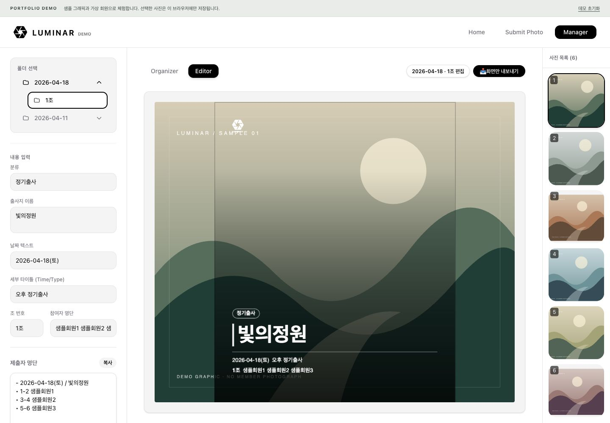

# LUMINAR

사진 업로드·관리와 SNS 썸네일 제작을 위한 웹 서비스입니다.
이 저장소에는 실제 운영 서비스를 바탕으로 만든 데모 코드를 공개했습니다.

단순한 반복 작업을 줄이고, 운영진이 동아리 운영에 집중할 수 있게 하자는 목표로 개발을 시작했습니다. 촬영 정보에 따른 자동 라벨링(파일명·폴더 정리), 사진 정렬, 간단한 썸네일 디자인 기능을 제공합니다.



## 프로젝트 소개

| 항목 | 내용 |
| --- | --- |
| 사용 대상 | 약 70명 규모의 대학생 사진 연합동아리 루미나르 |
| 담당 | 기획·설계·프런트엔드·백엔드 1인 개발 |
| 협업 | 디자이너 1명과 UI 디자인, 운영진 QA 및 피드백 반영 |
| 개발 과정 | 2024년 Google Apps Script MVP 제작 → Next.js 웹 서비스로 확장 |

공개용 데모에서는 회원 데이터, Google Drive 연결, 로그인 인증을 제외했습니다. 관리자 화면은 가상 회원과 샘플 그래픽을 사용하며, 기존 운영 저장소는 비공개로 유지합니다.

## 개발 배경

사진 동아리를 운영하면서 부원들의 사진을 쉽게 관리할 서비스가 필요했습니다. 출사가 끝나면 회원들이 카카오톡 단체방에 사진을 제출했고, 회장은 사진을 하나씩 내려받아 파일명과 날짜를 수정한 뒤 조별 폴더를 만들어 Google Drive에 업로드했습니다. 디자이너는 사진을 다시 다운로드해 SNS 게시물을 제작하고 게시했습니다.

유지비 0원과 비개발자 운영진도 쉽게 관리할 수 있는 서비스를 목표로 개발했습니다. 회장이 바뀌어도 개발자의 도움 없이 사용할 수 있도록 하는 것이 중요했습니다.

## 주요 기능

### 사진 제출

- 촬영 날짜·조·이름·출사지 입력 및 사진 업로드
- 날짜·조별 폴더 분류와 `이름-번호-출사지` 형식의 파일명 생성
- 이미지 축소 옵션, 미리보기, 처리 상태 표시



### Organizer — 사진 관리

- 날짜·조별 사진 조회 및 확대 보기
- 드래그 또는 이동 버튼으로 사진 순서 변경
- 정렬 결과에 맞춘 제출자 명단 복사 및 ZIP 다운로드



### Editor — SNS 썸네일 제작

- 선택한 사진에 날짜·조·장소·참여자 명단 자동 입력
- 사진과 텍스트 편집
- 표지 JPG 또는 표지와 사진을 묶은 ZIP 내보내기



## 기술 스택

| 영역 | 사용 기술 |
| --- | --- |
| 화면·API | Next.js App Router, React, TypeScript |
| 스타일·인터랙션 | Tailwind CSS, Framer Motion |
| 운영 서비스 저장소 | Google Drive API v3, OAuth2 |
| 이미지 처리·편집 | Canvas API, Fabric.js |
| 파일 내보내기 | JSZip |
| 공개 데모 저장소 | IndexedDB, Blob URL |

운영비 0원을 목표로, 별도 서버 관리 부담이 적은 서버리스 구성을 선택했습니다. 기존에 사용하던 Drive를 저장소로 활용하고 UI와 API를 Next.js 프로젝트에서 함께 관리했습니다.

[서비스 구조와 코드 안내 →](docs/architecture.md)

## 개발 과정과 문제 해결

2024년에는 GAS로 사진 제출 MVP를 만들었습니다. 업로드 성능과 기능 확장의 한계를 겪으면서 Next.js로 옮겼고, 사진 관리와 표지 제작 기능을 추가했습니다.

| 문제 | 대응 |
| --- | --- |
| GAS의 Base64 이미지 중계 | 파일 업로드와 목록 조회를 분리하고, 목록은 파일 ID만 반환 |
| Drive 직접 업로드 테스트 중 CORS 오류 | Next.js 서버를 거치는 업로드로 변경 |
| Service Account의 저장공간 오류 | 사용자 Drive를 사용하는 OAuth2 인증으로 전환 |
| 동시 업로드 시 같은 폴더가 중복 생성됨 | 폴더 초기화 분리, 동일 폴더 생성 요청의 Promise 공유 |
| 폴더명 불일치로 루트 폴더 조회 실패 | 폴더 ID로 직접 지정하는 방식 추가 |

[문제 원인과 해결 과정 자세히 보기 →](docs/product-decisions.md)

## 성과와 남은 과제

단체방에서 사진을 개별 다운로드하고, 파일명을 수정한 뒤 Drive에 다시 올리던 수동 작업을 사진 제출 기능으로 대체했습니다. 시간 절감률과 만족도는 별도로 측정하지 않았습니다.

동아리 내부 사용을 전제로 구현해 관리자 인증과 파일별 접근 권한 검증이 충분하지 않았습니다. 운영 서비스의 보안을 강화하는 것이 향후 개선 과제입니다. 공개 데모에서는 운영 API와 인증 연결을 제거했습니다.

## 데모 실행

Node.js 20.9 이상이 필요합니다.

```bash
npm ci
npm run dev
```

- Manager(Organizer·Editor)는 가로 1,200px 이상의 PC 브라우저에서 이용해주세요.
- JPG·PNG·WebP를 한 번에 최대 4장, 한 장당 12MB까지 선택할 수 있습니다.
- 선택한 사진은 이 브라우저의 IndexedDB에 저장됩니다. 상단의 ‘데모 초기화’로 삭제할 수 있습니다.

정적 파일 빌드와 미리보기:

```bash
npm run build
python3 -m http.server 4173 --bind 127.0.0.1 --directory out
```

[이미지 출처](docs/images/README.md) · 로고와 사진의 권리는 원저작자에게 있습니다.
