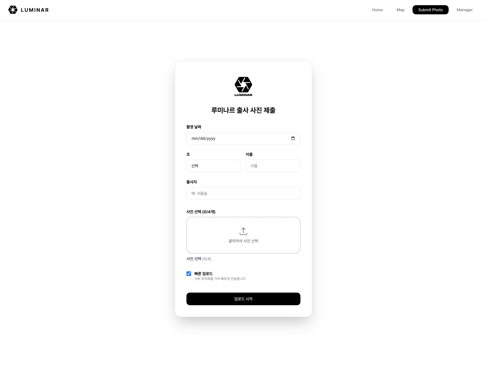

# LUMINAR | 루미나르 사진 관리 서비스

출사가 끝나면 사진 정리가 시작됐습니다. 카카오톡에 올라온 사진을 하나씩 내려받고, 이름을 바꾸고, Drive에 다시 올리는 일이었죠.

약 70명 규모의 대학생 사진 연합동아리에서 이 작업을 줄이려고 만든 서비스입니다. 2024년 Google Apps Script(GAS)로 시작해 Next.js로 확장했습니다.

> 이 저장소는 공개용 데모입니다. 실제 회원 데이터와 Drive 연결은 제외했습니다. Organizer와 Editor는 PC 브라우저에서 체험할 수 있습니다.

## 1. 프로젝트 개요

| 구분 | 내용 |
| --- | --- |
| 담당 | 기획·설계·프런트엔드·백엔드, 1인 개발 |
| 협업 | 디자이너 1명과 UI 디자인, 운영진 QA와 피드백 |
| 사용자 | 사진을 제출하는 회원, 운영진, SNS 콘텐츠 제작자 |
| 기술 | Next.js, React, TypeScript, Tailwind CSS, Google Drive API, Fabric.js, JSZip |

## 2. 어떤 문제를 풀었나

회원들은 출사 사진을 카카오톡 단체방에 올렸습니다. 회장이 사진을 다운로드해 파일명과 날짜를 정리하고 Drive에 업로드하면, 디자이너가 다시 내려받아 SNS 게시물을 만들었습니다.

사진만 모으면 끝나는 일이 아니었습니다. 촬영자와 출사 정보를 확인하고, 폴더를 나누고, 게시 순서와 표지도 준비해야 했습니다. 출사 때마다 반복됐습니다.

사진을 받을 때 필요한 정보를 함께 받기로 했습니다. 촬영 날짜·조·이름·출사지를 한 번 입력하면 파일 정리와 콘텐츠 제작에 다시 쓸 수 있도록 했습니다.

## 3. GAS에서 Next.js로

처음에는 GAS로 제출 MVP를 만들었습니다. 이미 쓰고 있던 Drive에 연결할 수 있어 시작하기 좋았습니다.

사진 업로드 성능과 기능 확장의 한계를 겪으면서 Next.js로 옮겼습니다. 초기 GAS 코드의 Base64 처리 대신 파일 업로드와 목록 조회를 분리했고, 목록에는 이미지 전체가 아닌 파일 ID를 반환했습니다. 이후 사진을 정리하는 Organizer와 표지를 만드는 Editor를 추가했습니다.

## 4. 주요 화면

### 사진 제출

날짜·조·이름·출사지를 입력하고 사진을 선택합니다. 날짜와 조에 맞춰 폴더를 만들고, 파일은 `이름-번호-출사지` 형식으로 저장합니다. 업로드 전 이미지 축소도 선택할 수 있습니다.


### Organizer

날짜와 조별로 사진을 조회하고 순서를 정합니다. 드래그나 앞·뒤 이동 버튼을 사용할 수 있습니다. 정렬한 순서대로 명단을 복사하거나 사진을 ZIP으로 받고, Editor로 넘깁니다.


### Editor

사진을 고르면 날짜·조·장소·참여자 명단이 표지에 채워집니다. 사진과 텍스트를 조정한 뒤 표지 JPG 또는 사진을 포함한 ZIP으로 내보냅니다.


<details>
<summary>홈페이지와 기존 서비스 화면</summary>

데모 홈페이지는 기존 메인 사진을 사용하고 소개 내용을 바꿨습니다. 관리자 데모에는 가상 회원과 샘플 그래픽을 넣었습니다.


아래는 기존 서비스의 사진 제출 화면입니다. 회원 정보가 보이는 관리자 원본 캡처는 공개하지 않았습니다.



</details>

## 5. 서비스 구조

기존 서비스는 Next.js App Router에서 화면과 API를 함께 관리합니다. 서버가 OAuth2 인증으로 Google Drive API v3에 접근합니다.

```text
사진 제출 → Canvas 이미지 축소 → Next.js API → Google Drive
Organizer → 폴더·사진 목록 API → 이미지 프록시 → 조회·정렬
Editor   → Fabric.js 캔버스 → JPG / JSZip 내보내기
```

이미지 최적화를 켜면 가로 폭을 최대 1,920px로 줄이고 JPEG quality 0.82로 인코딩합니다.

공개 데모는 서버 API 대신 IndexedDB를 사용합니다. 선택한 사진은 해당 브라우저에만 저장되며, 상단의 ‘데모 초기화’로 지울 수 있습니다. [데이터 흐름과 코드 위치](docs/architecture.md)는 별도 문서에 정리했습니다.

## 6. 개발하면서 바꾼 결정

**운영비와 관리 부담.** 운영비 0원을 목표로 서버리스 배포를 고려했습니다. Next.js는 UI와 API를 한 프로젝트에서 다룰 수 있었고, Drive는 기존 운영 방식에 연결하기 쉬웠습니다. 무료 한도와 이미지 전송량은 계속 살펴봐야 할 제약입니다.

**업로드 경로.** 브라우저에서 Drive로 직접 전송하려다 CORS 문제를 겪었습니다. Next.js가 파일을 받아 중계하도록 바꿨습니다. 업로드는 가능해졌지만 서버 메모리와 트래픽 부담이 생겼습니다.

**인증.** Service Account로 업로드할 때 저장공간 문제가 발생해 OAuth2로 돌아왔습니다. 사용자 계정의 Drive를 쓰는 만큼 Refresh Token과 계정 의존성을 관리해야 했습니다.

**폴더 중복.** 여러 사진이 같은 폴더를 동시에 만들면서 중복이 생겼습니다. 사진 전송 전에 폴더를 준비하고, 같은 폴더 생성 요청은 Promise를 공유하도록 바꿨습니다. 이 처리는 프로세스 내부에서만 동작합니다. 여러 서버리스 인스턴스 사이의 중복까지 보장하지는 않습니다.

대안과 제약은 [의사결정 기록](docs/product-decisions.md)에 더 자세히 남겼습니다.

## 7. 협업

개발은 혼자 맡았습니다. UI는 디자이너 1명과 협업했고, 운영진이 QA에 참여했습니다. 사용 중 받은 피드백을 반영하며 화면과 기능을 다듬었습니다.

## 8. 달라진 점

회장이 단체방 사진을 개별 다운로드하고, 파일명을 바꾸고, Drive에 재업로드하던 단계를 사진 제출 기능으로 대체했습니다. 운영진은 모인 사진에서 순서를 정하고 표지 제작으로 넘어갈 수 있게 됐습니다.

시간 절감률이나 만족도는 측정하지 않았습니다. 성과는 반복하던 수동 정리 단계를 없앴다는 점입니다.

## 9. 남은 과제

파일명에 정보를 담는 방식은 간단했지만 구분자나 이름이 바뀌면 파싱이 까다로워집니다. 사진 정보와 정렬 순서를 별도 데이터로 저장할 필요가 있습니다. 현재 순서는 화면과 다운로드에 반영되며 서버에 영구 저장되지는 않습니다.

기존 서비스의 주요 사진 화면은 원본 프록시를 사용합니다. 썸네일을 따로 만들고 이미지 전달 구조를 분리하는 것이 다음 개선 과제입니다. 인증과 파일 권한도 운영 규모에 맞춰 보완해야 합니다.

다음에는 제출 실패·재시도와 재정리 횟수, 게시물 제작 시간을 기록하고 싶습니다. 기능이 동작하는지에 더해 실제 업무가 얼마나 줄었는지도 확인하려고 합니다.

## 로컬 실행

Node.js 20.9 이상이 필요합니다. Google 계정이나 환경변수는 필요하지 않습니다.

```bash
npm ci
npm run dev
```

Manager는 가로 1,200px 이상의 PC 브라우저에서 이용해주세요. 제출은 JPG·PNG·WebP를 한 번에 최대 4장, 한 장당 12MB까지 지원합니다. 테스트 사진을 사용해주세요.

정적 파일을 빌드하고 미리 보려면 다음 명령을 실행합니다.

```bash
npm run build
python3 -m http.server 4173 --bind 127.0.0.1 --directory out
```

## 참고

- [구현 근거와 과거 기능 구분](docs/evidence.md) · [검증 기록](docs/validation.md)
- [이미지 출처와 공개 범위](docs/images/README.md)

기존 운영 저장소는 비공개로 유지합니다. 로고와 사진에 별도의 재사용 라이선스를 부여한 것은 아닙니다.
